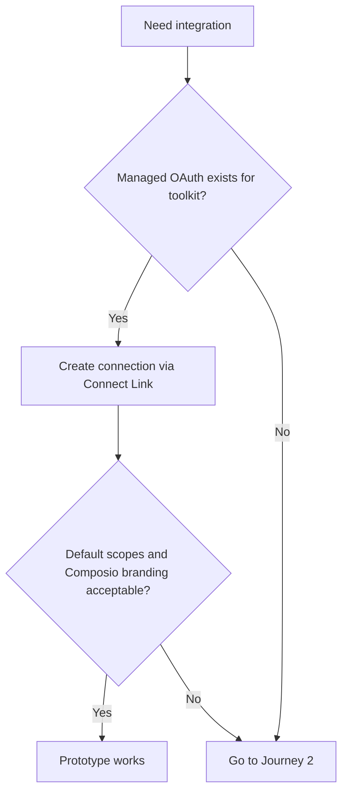
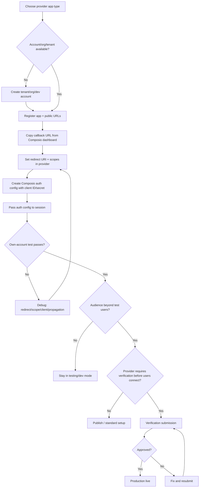
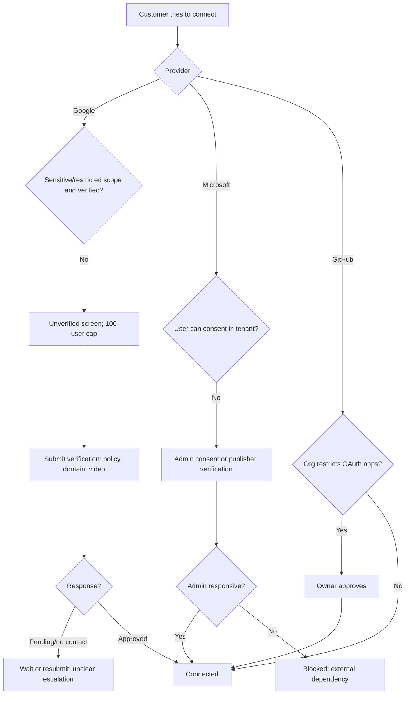

# Developer Pain Points in OAuth App Registration and Setup

Research for the Composio APM Integrations take-home. Research date: 2026-10-22 (first pass plus a second pass the same day). Research-only: no apps registered, no accounts created, nothing submitted.

> **HARD SCOPE RULE (applies to every section).** The tool's objective is to *"Build a working experience that gives developers and agent builders clear, actionable guidance for setting up an OAuth app and getting it approved."*
> - **In scope:**
>   - creating and configuring the provider OAuth app
>   - connecting it to Composio
>   - any provider approval, verification or admin consent that must happen **before the developer's users can connect through that app**. Examples: Google sensitive/restricted-scope verification, Microsoft publisher verification, customer admin consent (Microsoft, Atlassian, GitHub orgs, Salesforce), Salesforce enabling legacy Connected Apps, and Atlassian app approval or its warning.
> - **Out of scope:** optional marketplace or store listings and their reviews (Slack Marketplace, HubSpot Marketplace, Notion Marketplace, Salesforce AgentExchange, GitHub paid Marketplace), the install counts those listings require, and discovery or go-to-market. Users can connect without any of these.
> - **Caveat only:** limits that apply after setup, such as Slack's rate limits for unlisted apps. These may appear as one-line notes, never as a step, gate or timeline.
> - **Test for every finding:** "Does the developer need this before users can connect through their OAuth app?" If not, it is out of scope.
>
> Out-of-scope material from earlier passes is kept below only where it is labelled **[OUT OF SCOPE]**, so the evidence trail stays intact.

**Second-pass changes (summary):** read the Composio managed-OAuth directory and the full Composio docs dump; corrected the callback-URL finding (§8.5); re-read in the browser most sources that were snippet-only; added Stack Overflow evidence through the public Stack Exchange API, plus Hacker News; added GitHub Marketplace publisher verification, Salesforce AgentExchange (formerly AppExchange) security review, current Atlassian distribution, and Slack's 2025 rate limits for non-Marketplace apps. Reddit stayed inaccessible (see §3).

Evidence labels used throughout: **Documented** (official doc/policy), **Observed** (dated developer report), **Estimated** (my reasoning from documented steps), **Unknown**.

---

## 1. Executive summary

1. **"OAuth app ready" is four separate events, and developers conflate them.**
   - (a) creating a client ID and secret
   - (b) a user consenting
   - (c) provider app or scope verification (Google verification, Microsoft publisher verification, Atlassian app approval)
   - (d) enterprise or customer admin consent
   
   A local OAuth flow only proves (a) and (b), for the developer's own account. Getting real users connected depends on (c) and (d), wherever the provider requires them. Marketplace or store listings are a separate, optional event and are **out of scope**: for example, Slack apps work for any workspace once public distribution is on, with no review ([Slack distribution](https://docs.slack.dev/distribution)). [Google](https://support.google.com/cloud/answer/15549945) and [Microsoft](https://learn.microsoft.com/en-us/entra/identity-platform/publisher-verification-overview) draw the approval lines differently.
2. **Approval timelines are the largest source of uncertainty, and providers' own numbers disagree with each other and with developer reports.** Google's sensitive-scope page says "typically 3-5 business days" ([doc](https://developers.google.com/identity/protocols/oauth2/production-readiness/sensitive-scope-verification)); its verification-status page says "might require several months" ([doc](https://support.google.com/cloud/answer/7454865)); the restricted-scope page says "several weeks" ([doc](https://developers.google.com/identity/protocols/oauth2/production-readiness/restricted-scope-verification)). Developers on Google's forum report 5-9+ weeks stuck with no contact ([6 wk](https://discuss.google.dev/t/sensitive-scope-verification-stuck-6-weeks-never-received-any-trust-safety-email/376936), [9+ wk](https://discuss.google.dev/t/oauth-verification-being-verified-9-weeks-no-trust-safety-email-received/406882)). Microsoft publisher verification takes "minutes" once the prerequisites are met, but the Partner Center business verification it depends on has no published time and can stall indefinitely after a rejection (Observed, 2026). Atlassian app approval: no current figure; developers reported waits of 1 week to about 2 months in 2020. Slack, GitHub (standard OAuth apps), HubSpot and Notion need **no provider approval** before users can connect. Their marketplace reviews are out of scope.
3. **Testing mode is a trap, not a shortcut.** Google apps in "Testing" cap at 100 test users, show a warning, and refresh tokens expire after 7 days ([doc](https://support.google.com/cloud/answer/15549945), [doc](https://developers.google.com/identity/protocols/oauth2#expiration)). A demo that works Monday silently breaks the following week.
4. **Unverified-but-live has hard ceilings.**
   - **Google:** unverified apps requesting sensitive or restricted scopes are capped at 100 new users over the app's lifetime ([doc](https://support.google.com/cloud/answer/7454865)).
   - **Microsoft:** in tenants with risk-based step-up consent, users can't consent to unverified multitenant apps that ask for more than basic sign-in ([doc](https://learn.microsoft.com/en-us/entra/identity-platform/publisher-verification-overview)).
   - **Atlassian:** unapproved apps work, but users see a "not reviewed" warning.
5. **The work behind verification is large, and mostly not code.** Google: a public homepage and privacy policy on a domain you've verified ownership of, plus an unlisted YouTube demo video showing the client ID in the address bar and a justification for each scope. Microsoft: a Partner Center account, a matching verified domain, and a legal-entity name that matches the company's Dun & Bradstreet record.
6. **Account/identity prerequisites differ sharply by provider.** Microsoft publisher verification needs a work/school Entra account (not a personal Microsoft account), a verified Partner Center global account, and a domain match. Google needs Search Console domain ownership for verification. Salesforce has stopped letting new orgs create Connected Apps by default (External Client Apps replace them). These can be hard blockers a personal-email developer cannot clear.
7. **Enterprise admin gates are separate and sit outside the developer's control:** Microsoft admin consent / unverified-publisher blocking, GitHub org OAuth-app policy, Google Workspace admin restrictions (`admin_policy_enforced`), Salesforce admin pre-authorization.
8. **Composio-specific handoff friction found (corrected in second pass):** the current Composio docs consistently give `https://backend.composio.dev/api/v3/toolkits/auth/callback` (8 occurrences in the full docs dump, plus a migration note saying it replaced `/api/v1/auth-apps/add`). But the `next.docs` preview page shows `/api/v3.1/toolkits/auth/callback`, and two Composio Knowledge Base entries (Jira, Confluence) say *not* to reuse "legacy v1 or v3 callback paths from older examples." Read literally, that contradicts the main docs. Composio's own KB names copying an old callback from a legacy example as "a common cause of setup failure" (ClickUp entry). Also: creating an auth config is not enough; it must be passed to the session, and existing connections don't move to the new config.
9. **Most OAuth toolkits in Composio's catalog need the developer's own app.** Composio's [managed OAuth directory](https://docs.composio.dev/toolkits/managed-auth) listed **124 toolkits with Composio-managed OAuth and 223 marked "Bring your own OAuth app"** (read 2026-10-22). The managed list includes Gmail, Google Drive/Calendar/Sheets, Slack, GitHub, HubSpot, Salesforce, Notion, Jira, Confluence, Outlook, Microsoft Teams, Dropbox and Zoom. The bring-your-own list includes Shopify, Xero, DocuSign, ServiceNow, Workday, NetSuite, Pipedrive, Spotify, Twitter, Meta Ads, Google Chat, Google Admin and many vendor MCP servers. So the custom-app journey is the norm for most of the catalog, not an edge case.
10. **Caveat only: Slack throttles unlisted apps after setup.** Slack setup needs no approval. But since 2025-05-29, apps distributed commercially outside the Marketplace can read message history (`conversations.history`, `conversations.replies`) only once per minute, 15 messages per call ([Slack changelog](https://docs.slack.dev/changelog/2025/05/29/rate-limit-changes-for-non-marketplace-apps)). This belongs in a guide as a one-line note; it is not a setup or approval step.
11. **Strongest implication for the assignment:** the guide a developer needs is not "how to register an app" but "which of the four events applies to me, what will it cost in effort and calendar time, and who must act." Static per-app guides should lead with a verdict (difficulty, who can unblock you, waiting-time range with evidence label) before steps.
12. **Confidence caveat:** this is public-source research of vendor-authored docs plus a small number of forum threads. It cannot say how common any failure is. See §2 and §11.

---

## 2. Assignment interpretation

Source: the Notion take-home, read in full via the built-in browser (the page is JS-rendered and required a rendered read). Verbatim essentials:

- **Problem:** A developer building an AI agent wants users to connect an app; they may need their own provider OAuth app and approval. They piece together docs and email providers; it's hard to tell if setup is "an hour or weeks of waiting", how much work, or what blocks approval.
- **Assignment:** Build a working experience giving clear guidance: where to start, what next, time/effort expectations, how to proceed at a blocker. Goal: a library of guides for 100 OAuth apps, plus a submit-an-app flow where an agent investigates and generates a shareable guide in real time, including apps outside the library. For the take-home: a few varied apps plus the live-generation flow. Use agents to investigate and attempt as much setup as practical; be clear what was tested, what sources support, what is uncertain.
- **Starting point named:** understand what a provider OAuth app is and how it relates to the developer's integration and users' connections; the managed OAuth app directory.

**How this research serves it:** it supplies (a) the journey and stage model a guide template should follow, (b) the provider-specific facts and uncertainty ranges for six seed providers + Notion and Atlassian, (c) the pain-point inventory that tells the live-generation agent what to look for, and (d) the labeling scheme (Documented/Observed/Estimated/Unknown) the assignment's "what remains uncertain" requirement implies.

**Not accessed / not verified (flagged explicitly, updated after second pass):**
- **Composio managed OAuth directory: read** in the browser (124 managed / 223 bring-your-own; §1, §8.5). The **Composio dashboard was not opened**, because it needs an account and this was research-only. So the callback URL that the dashboard actually shows is still unverified.
- **Composio docs:** the full current docs (`docs.composio.dev/llms-full.txt`, ~1.4 MB) were downloaded and searched for every callback-URL mention. The `.../docs/troubleshooting/authentication` URL returns 404; the troubleshooting content now lives in the Knowledge Base (`/kb`), which is included in that dump.
- **Reddit: still not accessed.** The search tool refuses reddit.com, and the built-in browser blocks it under safety restrictions. No Reddit evidence is in this report.
- **Stack Overflow:** the site showed a human-verification CAPTCHA, which I did not attempt to bypass. Instead I queried the public **Stack Exchange API** (`api.stackexchange.com`) for question titles, scores, view counts, dates and top answers. Stack Overflow evidence is therefore limited to what the API returns.
- **Hacker News:** accessed; the relevant threads are mostly 2019-2020 and are flagged as dated.
- **Re-read in the browser in full (previously snippet-only):** Salesforce CLI connected-app page, Google branding help (the old `10311615` link now redirects to `15549049`), the Google forum tag listing and six threads, the Slack Marketplace write-up, the Microsoft MPN Q&A, the Partner Center rejection thread, and Microsoft's consent troubleshooting page.
- **Still snippet-only:** CircleCI article (now 404), HubSpot community thread (403), Nylas, Unipile, Striim, ServiceMax, Apideck.
- No real time-on-task measurement was possible (research-only; no apps were registered). All active-effort numbers are **Estimated**.

---

## 3. Scope and methodology

**Providers and application types** (type matters; they are not interchangeable):

| Provider | Product studied |
|---|---|
| Google | Google Cloud project + Google Auth Platform OAuth 2.0 client (web app), External audience |
| Microsoft | Entra ID app registration, multitenant delegated permissions |
| Slack | Slack app (OAuth & Permissions) with public distribution (Marketplace out of scope) |
| GitHub | OAuth App vs GitHub App (both distinguished) |
| Salesforce | Connected App (legacy) vs External Client App (current) |
| HubSpot | Public app (OAuth) in a developer account (Marketplace out of scope) |
| Notion | Public integration (Marketplace out of scope) |
| Atlassian | OAuth 2.0 (3LO) app in developer console |

**Source categories (after second pass):** official docs/policies (~27), vendor-run community forums (~20, mostly Google's developer forum, Microsoft Q&A/TechCommunity and Atlassian's developer community), Stack Overflow via API (~7 questions), Hacker News (1 thread used), third-party vendor docs and blogs (~8), and one individual developer write-up (Slack, read in full). Total unique sources: about 65 rows in §12. Coverage is still uneven (see below).

**Search approach:** about 35 focused web searches plus direct browser reads. Stack Overflow was queried through the Stack Exchange API, sorted by votes, for: `redirect_uri_mismatch`, "refresh token 7 days testing", "oauth verification sensitive scopes", `AADSTS90094`, "publisher verification MPN", Slack non-distributed app, HubSpot scope mismatch, and Salesforce `OAUTH_APPROVAL_ERROR_GENERIC`.

**A demand proxy, not prevalence:** the canonical Stack Overflow question "Google OAuth 2 authorization - Error: redirect_uri_mismatch" (2012) has **~1.32 million views and a score of 691** ([SO 11485271](https://stackoverflow.com/questions/11485271/google-oauth-2-authorization-error-redirect-uri-mismatch)). That is the strongest single signal found that redirect-URI configuration is a mass-scale setup failure. View counts accumulate over 14 years and include repeat visitors, so they are not a failure rate.

**Limitations:** (1) The search tool is US-only and summarizing, so I could not observe the exact queries developers use. (2) Forum samples are self-selected complainers. (3) Google forum threads are mostly June-October 2026 (freshest); Atlassian (2020-22) and Hacker News (2019) are old and flagged. (4) Reddit could not be accessed at all.

**Depth by provider:** Google (deep), Slack (deep), Microsoft (medium-deep), Salesforce (medium), HubSpot (medium), GitHub (medium: docs only, no developer reports), Atlassian (medium, dated evidence), Notion (shallow).

---

## 4. End-to-end developer journey

### 4.1 Stage model (adjusted to what providers actually require)

| Stage | What the developer does | Typical question | Main friction found |
|---|---|---|---|
| A Discover docs | Searches "<provider> OAuth setup"; lands on provider guide, Composio guide, blog posts | "Which guide is current? What's the full checklist?" | Fragmented: Google splits across Cloud Console help, `developers.google.com` guides, and a separate Verification Center; Slack moved `api.slack.com` to `docs.slack.dev` (old URLs redirect, e.g. confirmed 302); Salesforce docs still describe Connected Apps while creation is disabled by default |
| B Prerequisites/account | Chooses account/email/domain | "Can I use Gmail? Do I need a company domain?" | See §6 |
| C Register app | Creates project/app, client ID/secret, redirect URI | "Which app type? What goes in each field?" | Redirect mismatch, wrong field (JS origins vs redirect URIs), propagation delays |
| D Scopes | Picks scopes | "Which scope is the minimum?" | Scope classes (non-sensitive/sensitive/restricted) change the approval path |
| E Test | Runs the flow with own account | "Why does it work for me but not my user?" | Testing-mode caps, 7-day token expiry, private-by-default apps (Atlassian 3LO) |
| F Verify/approve | Provider verification (Google), publisher verification (Microsoft), app approval (Atlassian), customer admin consent. Marketplace listing is out of scope | "Do I need approval at all? How long?" | Video, policy pages, domain, Partner Center; opaque queues |
| G Debug | Interprets errors | "What does this error mean?" | Same symptom, multiple causes |
| H Handoff to Composio | Copies callback URL, creds, creates auth config, passes to session | "Where do I put this?" | Two dashboards + doc pages; config not applied until passed to session |

### 4.2 Journey 1 - Quick prototype (managed OAuth available)

**Goal:** get an agent calling Gmail/Slack/GitHub this afternoon. **Trigger:** demo or hackathon. **Evidence:** Documented (Composio) + Estimated.

| Step | User question | Docs | Decision | Outcome |
|---|---|---|---|---|
| 1 Check if toolkit has managed auth | "Do I need my own app?" | [Managed vs custom](https://docs.composio.dev/docs/authentication/custom-app-vs-managed-app) | managed vs custom | Documented: managed = Composio's app, default scopes |
| 2 Connect with Connect Link | "Why does consent say Composio?" | white-labeling page | accept branding | Works for developer immediately |
| 3 Divergence | "Can my users use this in production?" | - | stay managed or go custom | Managed consent screen shows Composio's name; custom scopes/branding/rate limits need custom config (Documented) |

**Active time:** Estimated minutes. **Waiting:** none expected. **Dependencies:** none. **Confidence:** medium (rests on Composio docs; I did not run it).

### 4.3 Journey 2 - Custom OAuth app, production-ready

**Goal:** branded, custom-scope, production integration. **Evidence:** Documented steps; Estimated times.

| # | Step | Docs/tools | Question | Failure points |
|---|---|---|---|---|
| 1 | Decide provider app type (e.g. GitHub OAuth App vs GitHub App; Salesforce ECA) | provider docs | "Which product?" | Wrong type is not always switchable; Entra `signInAudience` cannot be changed in the manifest (Observed, Microsoft Q&A) |
| 2 | Get account/org/tenant | provider console | "Do I need a company account?" | Entra needs a tenant; Salesforce needs an org |
| 3 | Register app, set homepage/privacy/terms | provider console | "What URLs?" | Needs public pages on a domain you own for verification |
| 4 | Copy Composio callback URL from dashboard | Composio dashboard | "Which callback URL is right?" | Doc pages show two different paths (see §8.5) |
| 5 | Paste into provider redirect URIs; select scopes | provider console | "Exact match?" | Trailing slash, http/https, wrong field; propagation delay |
| 6 | Copy client ID/secret into Composio auth config | Composio dashboard | | Wrong secret -> `invalid_client` |
| 7 | Pass auth config ID into session | Composio SDK | "Why still managed?" | Documented: config alone isn't enough |
| 8 | Test with own account | - | | Works in testing mode |
| 9 | Move to production / request verification | provider | "What do I submit?" | Weeks of waiting; may need video, policies |
| 10 | Re-authorize existing users | Composio | | Existing connections stay on old config (Composio docs) |

### 4.4 Journey 3 - Blocked by verification, admin consent, or hidden prerequisite

**Goal:** customer in a larger org can connect. **Evidence:** Observed (forums) + Documented.

| Scenario | What happens | Source | Developer's next action |
|---|---|---|---|
| Google sensitive scope, pending | Stuck at one checklist item for 6+ weeks, no email thread to reply to | [Observed 2026-06-30](https://discuss.google.dev/t/sensitive-scope-verification-stuck-6-weeks-never-received-any-trust-safety-email/376936) | Wait; resubmit (did not help in that report); no known escalation path |
| Microsoft customer tenant blocks consent | AADSTS65001/90094; admin must consent; unverified publisher blocks in some tenants | [Documented](https://learn.microsoft.com/en-us/entra/identity-platform/publisher-verification-overview); [Observed](https://learn.microsoft.com/en-us/troubleshoot/entra/entra-id/app-integration/troubleshoot-consent-issues) | Ask customer admin; or get publisher-verified |
| Publisher verification fails | MPN not found / wrong account type / domain mismatch | [Observed Q&A](https://learn.microsoft.com/en-us/answers/questions/1805273/mpn-id-not-found-or-you-dont-have-access-to-it) | Fix account/domain in Partner Center; may be a separate vetting wait |
| GitHub org restricts OAuth apps | Authorization "succeeds" but org data is not accessible until an owner approves | Documented ([GitHub](https://docs.github.com/en/organizations/managing-oauth-access-to-your-organizations-data/approving-oauth-apps-for-your-organization)) | Request owner approval |
| Salesforce | Needs admin pre-authorization policy; new Connected Apps disabled by default | Documented + Observed | Use ECA; admin sets Permitted Users |

---

## 5. Provider comparison

Times in the "Eff./wait" column are **Estimated** unless tagged; see §9 for the reasoning.

### 5.1 Google (Google Cloud / Google Auth Platform, External OAuth client)

- **Setup steps (Documented):** Cloud project -> configure Auth Platform (branding, audience, data access) -> create OAuth client -> add redirect URIs -> enable the specific Google APIs separately from scopes. Source for audience/testing: [Manage App Audience](https://support.google.com/cloud/answer/15549945).
- **Testing:** up to 100 test users; users see a warning; authorizations expire after 7 days (Documented, same page). Exemption only for basic profile/email/openid scopes.
- **Refresh tokens:** 7-day expiry in Testing; 100-refresh-token-per-client-per-account cap with silent invalidation of the oldest; 6-month inactivity expiry ([doc](https://developers.google.com/identity/protocols/oauth2#expiration)).
- **Verification trigger (Documented):** sensitive or restricted scopes; non-sensitive-only apps need only brand verification to show name/logo ([doc](https://support.google.com/cloud/answer/13463073), read via fetch tool summary).
- **Exceptions (Documented):** personal use, dev/test/staging, internal org use, domain-wide installs (still verified if sensitive/restricted).
- **Submission artifacts (Documented):** public homepage on a domain verified in Search Console; privacy policy on the same domain linked from consent screen; scope justification; up to 3 docs links; unlisted YouTube video of full flow in English showing consent screen, client ID in address bar, and each scope's functionality ([sensitive](https://developers.google.com/identity/protocols/oauth2/production-readiness/sensitive-scope-verification), [restricted](https://developers.google.com/identity/protocols/oauth2/production-readiness/restricted-scope-verification)).
- **Restricted scopes:** adds CASA security assessment by Google-empanelled assessors when data passes through a third-party server; annual recertification (Documented).
- **Timelines:** documented figures conflict (3-5 business days / several weeks / several months). Observed: 5-6+ weeks stuck with no Trust & Safety email ([thread 1](https://discuss.google.dev/t/sensitive-scope-verification-stuck-6-weeks-never-received-any-trust-safety-email/376936), [thread 2](https://discuss.google.dev/t/oauth-sensitive-scope-verification-stuck-on-privacy-policy-review-for-5-weeks-no-trust-safety-email-received/374799), plus a cluster of similar titles on [the tag page](https://discuss.google.dev/tag/oauth-app-verification/413)). Costs of CASA: not stated in the page I read -> Unknown from this research.
- **While pending:** app is usable; unverified screen shows; 100 new-user lifetime cap; cap "can be adjusted case by case" (Documented).
- **Known blockers:** unverified warning; homepage/privacy checks failing for small reasons; "Pending developer action" with no mail thread (Observed, multiple threads, mid-2026).
- **Propagation:** redirect URI edits may take minutes to appear. This is Observed in the accepted answer on [SO 11485271](https://stackoverflow.com/questions/11485271/google-oauth-2-authorization-error-redirect-uri-mismatch): "Generally only a few minutes but sometimes it seems longer". The second-highest answer (score 221) lists www vs non-www, http vs https, and trailing slash as the usual mismatches. A "few hours" bound is not substantiated.
- **Branding prerequisites (Documented, read in full, [Manage OAuth App Branding](https://support.google.com/cloud/answer/15549049)):**
  - Homepage, privacy policy and ToS links are "required for all external production apps", and you cannot submit for verification without them.
  - The homepage must be on a verified domain you own, must describe the app, and "can not be only a login page".
  - The privacy policy must be on the homepage's domain and identical on the homepage and the consent screen.
  - Brand changes create a new draft that may need re-verification. Verified branding must be published within 7 days.
  - You must have published branding before you can request data-access (scope) verification.
  - The older help URL `answer/10311615` now redirects here, so many blog and Stack Overflow links point at a page that has moved.
- **New Observed cluster, Sept-Oct 2026 ([tag page](https://discuss.google.dev/tag/oauth-app-verification/413), 30 most recent topics read 2026-10-22):**
  - **Personal-use apps cannot leave Testing.** At least 8 of the 30 latest topics report "Publish app" disabled for personal-use or desktop apps even though Branding is complete ([e.g.](https://discuss.google.dev/t/google-auth-platform-publish-app-disabled-for-external-testing-personal-use-oauth-app/402925), Oct 9 and Oct 19, 2026; no answer). In practice those developers are stuck with 7-day tokens.
  - **"Prepare for verification" permanently disabled.** The Branding page has no Verify button ([thread](https://discuss.google.dev/t/verification-center-prepare-for-verification-permanently-disabled-branding-page-has-no-verify-branding-button/381088), opened July 14, 2026, about 20 replies, 872 views, latest Oct 20, no Google staff reply). One user reported a workaround: a small icon next to "Branding" that reveals the option. Others report that the old verification contact form returns 404, and that Basic support cannot open technical cases.
  - **Scope label conflicts with behaviour.** `business.manage` is shown as non-sensitive, yet external users get 403 `access_denied` and there is no submit path ([thread](https://discuss.google.dev/t/oauth-business-manage-shown-as-non-sensitive-in-auth-platform-but-backend-blocks-all-external-users-with-error-403-access-denied-no-submit-for-verification-path-exists/384175), July 23 to Oct 21, 2026, unresolved).
  - **"In production" but still 7-day tokens.** A fresh consent still returned `refresh_token_expires_in=604799` ([thread](https://discuss.google.dev/t/oauth-app-is-reported-in-production-but-fresh-offline-consent-still-returns-a-seven-day-refresh-token/406448), Oct 19, 2026). A community reply says the status change can take hours to reach the consent screen; that is unconfirmed.
  - **Scope reduction to avoid CASA still stalls.** One developer removed `gmail.readonly` (restricted) to avoid CASA, submitted with `gmail.send` only on Aug 19, 2026, and was still "being verified" 9+ weeks later with no email ([thread](https://discuss.google.dev/t/oauth-verification-being-verified-9-weeks-no-trust-safety-email-received/406882)).
- **Long-running pattern (dated, Observed):**
  - A 2019 Stack Overflow question "consent screen stuck in verification for almost a year" ([SO 59248311](https://stackoverflow.com/questions/59248311/google-api-oauth-consent-screen-stuck-in-verification-for-almost-a-year)).
  - A 2018 question "verification form submitted but no response" (~48k views, [SO 52561945](https://stackoverflow.com/questions/52561945/google-oauth-developer-verification-form-submitted-but-no-response-from-google)). Its answers explain that the submit button only appears after sensitive scopes are declared, and those can only be added after the matching API is enabled. This is an ordering trap.
  - A 2019 Hacker News thread on Gmail verification ([HN 20245100](https://news.ycombinator.com/item?id=20245100)): the Mailspring author reports Google asking for a security audit after about 3 months, quoted at $15,000; others cite $15k-$75k assessment fees and reviewers replying about once a week. These fee figures are 2019 and predate CASA, so do **not** use them as current costs. Current CASA cost: Unknown.

### 5.2 Microsoft (Entra ID app registration)

- **Prereqs (Documented, page dated 2026-05):** an Azure account with an active subscription (free sign-up linked), at least the Application Developer role, and a workforce or external tenant ([doc](https://learn.microsoft.com/en-us/entra/identity-platform/quickstart-register-app)).
- **Account types (Documented):** single tenant, multitenant, multitenant + personal MSA, personal only. Observed: a personal account's default tenant has no directory and blocks some actions; fix reported is to create a new tenant ([Q&A](https://learn.microsoft.com/en-us/answers/questions/2127352/how-to-move-an-azure-application-created-under-a-p)); signInAudience cannot be edited later.
- **User consent:** if tenant policy blocks user consent, users hit AADSTS65001/90094; admin consent needed ([Microsoft troubleshooting](https://learn.microsoft.com/en-us/troubleshoot/entra/entra-id/app-integration/troubleshoot-consent-issues); vendor explanation [Nylas](https://developer.nylas.com/docs/cookbook/use-cases/build/fix-admin-approval-error/)).
- **Publisher verification (Documented):** needs verified Microsoft AI Cloud Partner Program (Partner One) global account; app registered with an Entra work/school account (MSA-registered apps cannot be verified); tenant associated with the PGA; publisher domain set and not `*.onmicrosoft.com`; CPP verification email domain must match publisher domain or a DNS-verified custom domain; initiating user needs Application/Cloud Application Admin in Entra and CPP Admin/Account Admin in Partner Center, signing in with MFA. "Verified in minutes" once prerequisites are met; no cost. Not supported in national clouds. Since Nov 2020, with risk-based step-up consent enabled, users cannot consent to newly registered unverified multitenant apps requesting more than basic sign-in ([doc](https://learn.microsoft.com/en-us/entra/identity-platform/publisher-verification-overview)).
- **Consent error catalogue (Documented, [troubleshooting page](https://learn.microsoft.com/en-us/troubleshoot/entra/entra-id/app-integration/troubleshoot-consent-issues), ms.date 2025-01-15, updated 2026-02):** nine distinct causes produce "Need admin approval":
  - missing User.Read
  - user consent disabled in the tenant
  - user assignment required
  - no service principal for the client
  - no service principal for the resource
  - `prompt=consent` left in the URL
  - unconsented scopes
  - scope needs admin consent
  - user consent blocked for risky apps (AADSTS900941)
  
  The page notes that admins "might not know what these permissions do" and must work with the vendor. So the developer, not Microsoft, has to explain scopes to the customer's admin. Stack Overflow shows the same error has caught developers since 2017 ([SO 46689484](https://stackoverflow.com/questions/46689484/microsoft-graph-api-aadsts90094-the-grant-requires-admin-permission), ~4.7k views; [SO 48124379](https://stackoverflow.com/questions/48124379/azure-ad-app-registration-aadsts90094-the-grant-requires-admin-permission-er), ~7.4k).
- **Observed failures (read in full):**
  - **"MPN ID not found"** ([Q&A, July 2024](https://learn.microsoft.com/en-us/answers/questions/1805273/mpn-id-not-found-or-you-dont-have-access-to-it)). The moderator lists three causes: missing Partner Center role, tenant not linked to the CPP account, or invalid ID. The fix spans three Partner Center pages plus Entra custom domains, and the moderator adds "wait a few hours" for association to propagate. Resolution is unconfirmed.
  - **Business verification rejected until appeals ran out** ([TechCommunity, July 31, 2026](https://techcommunity.microsoft.com/discussions/partnercomplianceforum/business-verification-rejected-appeals-exhausted-no-support-path/4542935)). A single-member LLC was rejected several times, apparently because the app or brand name did not match the D&B legal name. Appeals were exhausted, document upload was blocked, and support routed only to bots. A community manager replied with a support-ticket guide and "message me if no reply in 10 days". Unresolved. This shows the **legal-entity name** must match D-U-N-S records: a hidden prerequisite for solo founders.
- **Timelines:** publisher verification takes "minutes" once prerequisites are met (Documented). The Partner Center **business verification** that comes first: Unknown, and Observed to be open-ended when rejected.

### 5.3 Slack

**Scope verdict: no provider approval is needed before users can connect.** In-scope steps:
- Create the app.
- Set scopes and redirect URLs under OAuth & Permissions.
- Activate Public Distribution.
- Get customer workspace admin approval where a workspace requires it.

- **Setup (Documented):** create app, OAuth & Permissions scopes, redirect URLs, install to workspace.
- **Public distribution (Documented, [distribution page](https://docs.slack.dev/distribution)):**
  - Required for any workspace other than your own.
  - Build OAuth, then click "Activate Public Distribution". HTTPS is required for all URLs.
  - **No review.**
  - Customer workspaces may require admin approval. That is the in-scope approval gate for Slack.
  - Turning distribution off removes the app from all other workspaces.
  - Apps with scopes beyond `bot`/`commands`/`incoming-webhook`/`identify` are uninstalled if the installing user leaves.
  - Stack Overflow shows confusion about installing in other workspaces without the directory going back to 2017 ([SO 45523707](https://stackoverflow.com/questions/45523707/how-to-install-bot-in-multiple-teams-without-adding-it-to-the-directory), ~11.6k views).
- **Testing gotchas (Observed, same developer write-up as below):** the dashboard's "Install to Workspace" button skips your own OAuth flow, so the install handler never fires. Free ngrok URLs change on every restart, so five config fields need updating each time. Use a separate DEV app and test workspace.
- **Caveat only: rate limits after setup (Documented, [changelog 2025-05-29](https://docs.slack.dev/changelog/2025/05/29/rate-limit-changes-for-non-marketplace-apps)):** unlisted, commercially distributed apps can read message history (`conversations.history`, `conversations.replies`) only once per minute, 15 messages per call. Marketplace apps and companies' own internal apps are exempt. The changelog says existing installs are not affected, but the updated FAQ reportedly gives March 3, 2026; that conflict is unverified. Mention this in one line; it is not a setup step.

#### [OUT OF SCOPE] Slack Marketplace listing (kept for the evidence trail)
Sources: [distribution in the Marketplace](https://docs.slack.dev/slack-marketplace/distributing-your-app-in-the-slack-marketplace) and [review guide](https://docs.slack.dev/slack-marketplace/slack-marketplace-review-guide), both read through a fetch tool.
- **Marketplace requirements (Documented):** public landing, support, privacy pages; support response within 2 business days; least-privilege scopes each justified; TLS 1.2+; verify requests; `state` param; 1600x1000 images; collaborator added; **installed on 10+ active workspaces in past 28 days** before submit; AI/LLM disclosure.
- **Review (Documented):** preliminary up to 10 business days; functional up to 10 weeks (new) or 6 weeks (updates); resubmitting during preliminary resets queue place, not after reviewer assigned; Slack "cannot accelerate."
- **Reviewer access:** reviewers cannot access any Slack workspace, including test ones; you must provide an install path and test accounts for your own service.
- **Rejection comms (Documented):** feedback in the submission flow in app settings and by email.
- **Observed (read in full, Kamil Buksakowski, Level Up Coding, Aug 31, 2026, [post](https://levelup.gitconnected.com/how-i-published-my-own-app-in-the-slack-marketplace-and-what-the-docs-didnt-tell-me-776e365d0426)):** first commit Oct 2025; **submitted early January 2026, approved May 2026: about four months of review** for a ~2,600-line app with 5 bot scopes. Hidden work and surprises:
  - a custom domain, because Slack asked him to confirm the app's website belongs to him
  - a privacy policy and support page
  - a support-email forward
  - an "extensive" data-handling form
  - staged screenshots, because real conversations can't be shown
  - a mandatory `help` response
  - per-scope justification
  - the dashboard's "Install to Workspace" button **skips your own OAuth flow**, so the install handler never fires; he only found this when his database stayed empty
  - free ngrok URLs change on every restart, so five config fields need updating each time
  - a separate DEV app and test workspace

  He reports that the confirmation email says fixes during the early stage reset your queue position (consistent with the doc). A later feature that used an already-approved scope shipped without re-review. One developer's experience; it does not establish a typical wait.

### 5.4 GitHub

- **Types (Documented):** OAuth Apps act as the user with broad scopes like `repo`; GitHub Apps get fine-grained per-repo permissions, installation tokens (~1 hour), and survive the installer leaving ([doc](https://docs.github.com/en/apps/oauth-apps/building-oauth-apps/differences-between-github-apps-and-oauth-apps)). GitHub recommends GitHub Apps; OAuth apps remain necessary for some enterprise-level resources.
- **Org gates (Documented):** with OAuth app access restrictions, members request and owners approve; unapproved apps see only public org resources ([doc](https://docs.github.com/en/organizations/managing-oauth-access-to-your-organizations-data/approving-oauth-apps-for-your-organization)). GitHub Apps needing org-level permissions need owner approval.
- **Observed (third party, snippet only; page now 404):** CircleCI said restrictions are on by default for new orgs, causing "authorized but no org access" ([CircleCI](https://support.circleci.com/hc/en-us/articles/38397680126619)). Not a GitHub source; low confidence.
- **Scope verdict:** no provider approval is needed before users can authorize an OAuth App or install a GitHub App. The in-scope gate is customer **org owner approval** (above).
- **[OUT OF SCOPE] Marketplace (Documented, [about Marketplace](https://docs.github.com/en/apps/github-marketplace/github-marketplace-overview/about-github-marketplace-for-apps)):** both OAuth Apps and GitHub Apps can be listed. Anyone can list a free app; only **organization-owned** apps can sell. Listing is optional; nothing I read requires it to let users authorize your app.
- **[OUT OF SCOPE] Marketplace publisher verification (Documented, [doc](https://docs.github.com/en/apps/github-marketplace/github-marketplace-overview/applying-for-publisher-verification-for-your-organization)):**
  - Required only for paid plans or a Marketplace badge.
  - The app must be owned by an organization (personal-account apps must be transferred first), and you need owner permission.
  - 2FA must be enabled for the org.
  - A verified domain must show a "Verified" badge on the org profile.
  - You must give a support email for GitHub updates.
  - Review timeline: not stated (Unknown).
- **Wait time:** none for creating an OAuth app or GitHub App (Estimated). The wait is on customer org owners. GitHub is the lowest-friction provider studied for getting to real users.

### 5.5 Salesforce

- **Product change (Documented; read in full in the browser, [CLI doc](https://developer.salesforce.com/docs/platform/sfdx-dev/guide/sfdx-dev-auth-connected-app.html)):** "Connected apps are being deprecated." "Creating connected apps is now disabled by default... Salesforce Customer Support must enable an org perm in your org. This is a one-time process per org" (Spring '26). External client apps are "the preferred integration framework." The same page has the admin turn on "Allow creation of connected apps" in External Client Apps settings. It also shows hidden details:
  - an email verification code to reveal the consumer key
  - the "Approve Uninstalled Connected Apps" permission
  - a recommended refresh-token expiry of 90 days or less, which forces periodic re-auth
  
  A ServiceMax note claims Connected Apps end in Winter '27; I could not confirm that from Salesforce, so it stays **conflicting/unverified**.
- **Scope verdict:** the in-scope gates are (1) getting the app created, either an External Client App or a Connected App (which now needs Salesforce Support to enable creation in the org), and (2) customer admin policies: "Admin approved users are pre-authorized", plus profile and permission-set assignment. The AgentExchange security review below is a listing review and is **out of scope**.
- **[OUT OF SCOPE] AgentExchange (formerly AppExchange) security review (Documented, [How the security review works](https://developer.salesforce.com/docs/platform/isvforce/guide/security-review-how-it-works.html), read in browser):**
  - Required to **distribute on AgentExchange** for managed packages and Salesforce Platform API solutions. It is not required just to connect your own external app to customer orgs (Inferred: the page only covers listing).
  - Prerequisites: ISV Partner Program enrollment, Lightning Ready certification, a connected packaging org, a provider profile, scanner runs (Code Analyzer, Checkmarx), and a Developer Edition org plus documentation for reviewers.
  - Stated typical times: **1-2 weeks** intake check, **3-4 weeks** first test, **2-3 weeks** per resubmission.
  - Free solutions don't pay the fee; paid ones do. The amount was not confirmed: an older guide version, v244, listed $999.
  - The doc says applicants who don't test first "rarely pass." A 2023 Salesforce blog cites a 6-9 week queue ([blog](https://developer.salesforce.com/blogs/2023/04/prepare-your-app-to-pass-the-appexchange-security-review), snippet), so the documented numbers have shifted over time.
- **Policies (Documented via search):** ECA OAuth policies - Permitted Users "Admin approved users are pre-authorized", IP relaxation settings.
- **Observed:** new-app propagation delays reported as ~2-10 minutes by vendors/community, `invalid_client_id` sometimes fixed by waiting or by PKCE settings ([3CX thread](https://www.3cx.com/community/threads/salesforce-authorize-token-fails-with-error-invalid_client_id-error_description-client-20identifier-20invalid.123507/), [Nango](https://www.nango.dev/blog/fix-salesforce-oauth-approval-error-generic)).
- **Key prerequisite:** a Salesforce org with admin rights (Developer Edition is the common free route, but I did not verify current sign-up terms).

### 5.6 HubSpot

- **Types:** developer account -> app; test accounts for installs. **Observed:** a developer portal itself has no scope-gated data; test on a test portal ([community](https://community.hubspot.com/t5/APIs-Integrations/Error-This-account-doesn-t-have-access-to-some-HubSpot-features/td-p/523108)).
- **Scope mismatch:** scopes in the app config must match the install URL; mismatch gives "insufficient scopes"/validation errors (Observed, [Apideck guide](https://developers.apideck.com/apis/crm/hubspot/configuration) and community threads). Free-tier test accounts may lack features for some scopes (Observed).
- **Scope verdict:** no provider approval found before customers can install through the app's install URL (Estimated: I did not see HubSpot state that unlisted apps can't be installed; verify). In-scope friction is configuration: scope matching and the test-account tier.
- **[OUT OF SCOPE] Marketplace listing (Documented, [requirements](https://developers.hubspot.com/docs/apps/developer-platform/list-apps/listing-your-app/app-marketplace-listing-requirements.md)):** 3+ active unique installs from unaffiliated production accounts (activity within 30 days); OAuth sole auth; scopes limited and all used; public setup docs, ToS, privacy, support URLs; "Shared data" table matching scopes; one app submitted at a time; initial review within 10 business days; full process no more than 60 days from when feedback shared; HubSpot can unpublish any time. Note: whether *only* listed apps can be installed by customers is not stated in what I read; an unlisted app can still be installed through its install URL (Estimated, not verified).

### 5.7 Notion

- **Scope verdict:** no provider approval is needed; "Using a public integration does not require listing" (Documented).
- **In scope (Documented):** public integrations use OAuth. The installation scope, "any workspace" or "selected workspaces", is set at creation and **cannot be changed later**. This is a rework trap if chosen wrong (no developer report found).
- **[OUT OF SCOPE] Marketplace listing:**
  - only "any workspace" integrations can be listed
  - review result by email in 5-10 business days
  - rejections for brand/trademark, quality or baseline criteria, with resubmission after edits
  
  Sources: [listing guide](https://developers.notion.com/guides/get-started/marketplace-listing); [publish guide](https://developers.notion.com/docs/publishing-integrations-to-notions-integration-gallery).

### 5.8 Atlassian (OAuth 2.0 3LO)

- **Observed/Documented:** apps are private by default; enable sharing/distribution to let other users install; distribution is separate from Marketplace listing ([community](https://community.developer.atlassian.com/t/do-i-really-need-to-list-my-oauth-2-0-3lo-app-on-marketplace-to-share-with-other-people/69937), summary).
- **Current process (Documented, [Managing OAuth apps](https://developer.atlassian.com/cloud/oauth/getting-started/managing-oauth-apps/), © 2026):**
  - Apps are private: "only you can install and use it."
  - To distribute: Distribution, then **Enable sharing**, then copy the authorization URL and send it to users. Installs are per user.
  - Users installing an *unapproved* app see a warning that Atlassian hasn't reviewed it. Approval goes through the Marketplace listing process, but an informative listing is not required to submit.
  - Adding or removing scopes forces existing users to re-consent.
  - You can't delete an app while it's installed anywhere.
  - The vendor name, privacy policy and personal-data declaration fields come from third-party guides (Nango, StackOne), not this page.
- **Sharing without approval is allowed (Observed, Atlassian staff, June 15, 2022, [thread](https://community.developer.atlassian.com/t/sharing-of-oauth-2-0-3lo-app-does-not-show-warning-that-the-app-has-not-yet-been-reviewed-by-atlassian/58967)):** "You can share the app without going through the approval procedure." Approval only removes the warning.
- **Customer-side gate (Documented, [Atlassian KB, updated 2026-07-21](https://support.atlassian.com/atlassian-cloud/kb/your-site-admin-must-authorize-this-app-error-in-atlassian-cloud-apps/)):** "Your site admin must authorize this app" means a site admin must approve the app under Atlassian Administration, then Apps, then Connected apps. Users cannot approve it themselves. This is the Atlassian counterpart of Microsoft admin consent.
- **Historic approval delays (Observed, 2020-21):**
  - Developers reported 3LO approval waits from 1 week to nearly 2 months, with little communication, across about 15 posts June-December 2020 ([thread p.3](https://community.developer.atlassian.com/t/how-long-does-it-take-to-get-3lo-approval/32415?page=3)).
  - Atlassian staff acknowledged in Dec 2020 they had been working "to improve the 3LO approval response time." In Jan 2021 staff said the backlog was cleared and simplified requirements to a privacy policy on the vendor's own domain plus account ID ([thread](https://community.developer.atlassian.com/t/oauth-2-0-3lo-public-distribution-how-to-get-approval-to-make-private-app-public/36168)).
  - **Current approval timing: Unknown.** The claimed "10 business days" objective appeared only in a search summary and I could not find it on the page.

### 5.9 Cross-provider snapshot

In-scope gates only. Marketplace listings are excluded under the scope rule.

| Provider | Own-app creation gate | Provider approval before users can connect | Customer-side approval | Published approval time | Evidence quality |
|---|---|---|---|---|---|
| Google | none (project) | **Yes** for sensitive/restricted scopes (verification; brand verification first). Without it: unverified warning, 100-user lifetime cap | Workspace admin restrictions (`admin_policy_enforced`) | conflicting: 3-5 BD / weeks / months; Observed 5-9+ wk stalls | Documented + many Observed |
| Microsoft | tenant + role | **Effectively yes for multitenant apps** (publisher verification) where tenants block unverified apps | Tenant admin consent | "minutes" after prerequisites; Partner Center vetting Unknown | Documented + Observed failures |
| Slack | none; Activate Public Distribution | **No** | Workspace admin approval where required | n/a | Documented |
| GitHub | none | **No** | Org owner approval | n/a | Documented |
| Salesforce | org; Support enablement for legacy Connected Apps (ECA preferred) | **No** provider review; Support enablement for legacy path | Admin pre-authorization, profiles and permission sets | Support enablement: Unknown | Documented |
| HubSpot | developer account | **No** found (verify) | n/a found | n/a | Documented (listing only) |
| Notion | workspace | **No** | n/a found | n/a | Documented |
| Atlassian | developer console + Enable sharing | **Optional** (approval removes "not reviewed" warning) | Site admin authorization | Unknown today; 1 wk to ~2 months in 2020 | Documented + dated Observed |

---

## 6. Email and account requirements

Distinguish the four email roles: (1) portal sign-in, (2) developer/support contact shown or used by reviewers, (3) domain-ownership/org identity, (4) mailbox receiving review mail.

| Provider | Account requirement | Email requirement | Domain requirement | Other prerequisites | Evidence | Confidence |
|---|---|---|---|---|---|---|
| Google | Any Google account can create a project (not read in full). Internal audience needs a Cloud Organization | User support email and developer contact email are separate fields; Google sends "critical information about your project" to the developer contact addresses ([branding help](https://support.google.com/cloud/answer/15549049), read in full). The rule that the support email must be the signed-in user's Google account or a Google Group they manage comes only from a snippet of the old `10311615` page, which now redirects; the current page does not say it, so it is **unverified** | Homepage on "a verified domain you own"; Search Console verification for authorized domains; privacy policy on the same domain | Homepage, privacy and ToS links "required for all external production apps"; homepage cannot be only a login page; Google Play/Facebook pages not accepted | Documented | Medium-high |
| Microsoft | Entra work/school account in a tenant; MSA-registered apps cannot be publisher verified; personal account default tenant lacks a directory | CPP account verification email domain must match publisher domain or a DNS-verified custom domain in tenant | Publisher domain required, not `*.onmicrosoft.com` | Partner Center global account; MFA; roles in both Entra and Partner Center | Documented ([overview](https://learn.microsoft.com/en-us/entra/identity-platform/publisher-verification-overview)) + Observed | High for verification rules; medium for consumer case |
| Slack | Slack workspace admin to create/install; developer-owned app | Developer and support contacts must be kept current; support must respond within 2 business days; status emails go to the submission address. Observed: one developer set up a forwarding address on his own domain to his personal inbox as the support email | Public landing/support/privacy pages; Observed: Slack asked him to confirm the website belongs to him, so he bought a custom domain | Add at least one collaborator | Documented + Observed | Medium-high |
| GitHub | Personal or org account creates OAuth/GitHub App; paid Marketplace needs org ownership | Publisher verification asks for "the best email address for support and updates from GitHub" | Verified domain on org profile (publisher verification only) | Org 2FA; org owner approval for org data access | Documented ([publisher verification](https://docs.github.com/en/apps/github-marketplace/github-marketplace-overview/applying-for-publisher-verification-for-your-organization)) | Medium |
| Salesforce | Org + admin; new Connected Apps disabled by default (Support enablement); ECA preferred | An email verification code is sent to the admin to reveal consumer key/secret (Documented, CLI page) | Not required for an own-org app; AgentExchange listing needs ISV Partner Program enrollment | Partner Program, Lightning Ready, Developer Edition org for reviewers (listing only) | Documented (read in full) | Medium |
| HubSpot | Developer account; marketplace needs public docs, ToS/privacy, support URL | At least one support contact method; HubSpot emails feedback | Public listing URLs; "HubSpot Crawler" allowlisting recommended | 3 unaffiliated installs | Documented | Medium |
| Notion | Workspace owner creates public integration | Review result by email | Not stated | Public, any-workspace installation | Documented | Medium |
| Atlassian | Developer console account | Account ID + vendor name; privacy policy on vendor's own domain (2021 staff statement) | Privacy policy on own domain (for approval) | Per-user install link; sharing toggle; customer site admin may need to authorize | Documented (2026 page) + Observed (dated) | Medium-low |
| Microsoft (add-on) | Partner Center business verification | — | Legal entity name must match D&B record (Observed 2026) | D-U-N-S number | Observed | Medium |

**Findings:**
- Personal email is accepted at sign-in for Google and (commonly) for registering on others, but **domain/org identity is where it breaks**: Microsoft publisher verification and Google verification both need a domain you control. A developer without a company domain can stay in testing/dev mode but, from the documents read, cannot clear these gates. This is a **documented inference**, not a single sentence in any doc.
- Google developer-contact mail is where reviewer questions arrive; forum reports show developers receiving **no** Trust & Safety email at all ([example](https://discuss.google.dev/t/oauth-verification-stuck-pending-developer-action-but-never-received-email-from-trust-safety/327111) - title read from search result). I could not determine whether this is a delivery problem or process delay.
- **Unknown:** whether changing contact emails mid-review restarts queues; whether Gmail vs Workspace affects review outcome. I found no evidence either way and will not assume.
- I do not recommend one email provider as universally best.

---

## 7. Pain-point inventory (ranked)

**Prioritization framework (transparent):** Score = Severity (1-3) x 2 + Evidence strength (1-3) + Time cost (1-3) + Blocks-progress (0/2) + Providers affected (1-3, capped). Max about 16. Scores are my judgment, not statistics. Evidence strength counts independent sources, not complaints. Anecdote counts are **not** prevalence.

| ID | Provider / type | Stage | Pain point | Evidence type | Frequency signal | Severity | Time impact | Blocker? | Score | Confidence |
|---|---|---|---|---|---|---|---|---|---|---|
| P1 | Google / External client | F | Verification stalls in "pending" with no contact; no escalation path | Observed ([1](https://discuss.google.dev/t/sensitive-scope-verification-stuck-6-weeks-never-received-any-trust-safety-email/376936), [2](https://discuss.google.dev/t/oauth-sensitive-scope-verification-stuck-on-privacy-policy-review-for-5-weeks-no-trust-safety-email-received/374799), [3](https://discuss.google.dev/t/oauth-verification-stuck-no-trust-safety-email-received-pii-removed-by-staff/385889)) | Repeated (many threads, one forum) | High | 5-10+ weeks reported | Hard blocker to production | 15 | Medium-high |
| P2 | Google | F | Official timeline statements conflict (3-5 BD vs weeks vs months) | Documented | Systemic | High | uncertainty itself | Planning blocker | 13 | High |
| P3 | Google | E | Testing mode: 7-day token expiry, 100 test users, warning screen | Documented | Systemic | High | recurring re-auth | Workaround: publish / re-consent | 13 | High |
| P4 | Google | F | 100-user lifetime cap for unverified sensitive-scope apps | Documented | Systemic | High | caps growth | Hard cap | 13 | High |
| ~~P5~~ | Slack | — | **[OUT OF SCOPE]** Marketplace listing needs 10+ active workspaces before submitting | Documented | — | — | — | Listing only | excluded | High |
| ~~P6~~ | HubSpot | — | **[OUT OF SCOPE]** Marketplace listing needs 3 unaffiliated active installs | Documented | — | — | — | Listing only | excluded | High |
| P7 | Microsoft / Entra | B/F | Publisher verification needs work/school account, CPP global account, domain match; MSA apps can't be verified | Documented + Observed ([Q&A](https://learn.microsoft.com/en-us/answers/questions/1805273/mpn-id-not-found-or-you-dont-have-access-to-it)) | Repeated | High | hours to days (Estimated) + unknown vetting | Hard blocker for enterprise | 14 | Medium-high |
| P8 | Microsoft | F/G | Customer tenant blocks user consent -> AADSTS65001/90094; depends on customer admin | Documented + Observed | Repeated | High | days-weeks (customer-side, Estimated) | External dependency | 14 | Medium |
| P9 | GitHub / OAuth App | F | Org restrictions: org owner must approve; app sees only public resources until then | Documented | Systemic for orgs | Medium | owner-dependent | External dependency | 10 | High (docs); low (frequency) |
| P10 | Salesforce | B/C | Connected App creation disabled by default; ECA is new; docs mixed | Documented (summary) + conflicting vendor claims | Systemic for new orgs | High | unknown (Support enablement) | Hard blocker for legacy path | 12 | Medium |
| P11 | Salesforce | G | New-app propagation delay and `invalid_client_id` | Observed (vendor/community) | Repeated | Medium | minutes (Observed) | Inconvenience | 8 | Medium |
| P12 | Google / all | G | Redirect URI mismatch: exact match (www, http/https, trailing slash), wrong field, propagation | Documented (GitHub/Composio) + Observed ([SO 11485271](https://stackoverflow.com/questions/11485271/google-oauth-2-authorization-error-redirect-uri-mismatch): ~1.32M views, score 691) | Widespread (strongest demand signal found) | Medium | minutes-hours | Inconvenience/workaround | 11 | High |
| P13 | HubSpot | D/G | Scope mismatch between app config and install URL; test-account tier lacks scope features | Observed (community) | Repeated | Medium | hours | Workaround | 8 | Medium |
| P14 | Notion | C | Installation scope ("any" vs "selected" workspaces) is immutable after creation | Documented | Systemic | Medium | rework | Rework | 8 | High (fact); low (impact) |
| P15 | Atlassian | E/F | App private by default; works for creator only; distribution ticket queue | Observed 2020-21 | Isolated/dated | Medium | ~weeks (2020-21) | Hard blocker for others | 7 | Low |
| P16 | Microsoft | C | Audience (signInAudience) can't be changed in manifest after creation; personal-account default tenant has no directory | Observed (Q&A) | Repeated | Medium | rework | Rework | 8 | Medium |
| P17 | Composio | H | Callback URL guidance conflicts: main docs say `/api/v3/toolkits/auth/callback`, `next.docs` preview says `/api/v3.1/...`, KB entries say don't reuse "legacy v1 or v3" paths; Composio's own KB calls copying an old callback "a common cause of setup failure" | Documented (inconsistency + Composio KB statement) | Repeated per Composio KB | Medium | failed connection + debugging | Hard if wrong URL used | 11 | Medium-high (dashboard still unchecked) |
| P18 | Composio | H | Auth config must be passed into session; existing connections stay on old config | Documented | Systemic | Medium | re-auth work | Workaround | 9 | High |
| P19 | All | A | Fragmented/moved docs (e.g., Slack `api.slack.com` -> `docs.slack.dev`) | Documented (redirect observed) | Widespread | Low-Med | minutes-hours | Inconvenience | 6 | Medium |
| P20 | Google, Microsoft (verification) | F | Hidden non-code work for verification: verified domain, homepage, same-domain privacy policy, demo video with client ID, scope justifications (Google); Partner Center account, domain match, D&B legal name (Microsoft) | Documented | Systemic | High | days (Estimated) | Required for approval | 12 | High |
| P21 | Google | E/F | Personal-use or desktop apps can't leave Testing ("Publish app" disabled), so they stay on 7-day tokens; no answers on forum | Observed (≥8 of 30 latest tag topics, Sept-Oct 2026) | Repeated | High | indefinite | Hard blocker | 13 | Medium |
| P22 | Google | F | Verification Center "Prepare for verification" disabled with no Verify button; old contact form 404; Basic support can't open case | Observed ([thread](https://discuss.google.dev/t/verification-center-prepare-for-verification-permanently-disabled-branding-page-has-no-verify-branding-button/381088), ~20 replies, 872 views) | Repeated | High | weeks | Hard blocker (one reported UI workaround) | 13 | Medium |
| P23 | Slack | caveat | **[CAVEAT ONLY]** Unlisted commercially distributed apps limited to 1 req/min and 15 objects on history/replies since 2025-05-29. Doesn't block setup or connection | Documented | Systemic | — | after setup | Not a setup gate | not ranked | High |
| P24 | Slack | E | Dashboard "Install to Workspace" skips your own OAuth flow, so install handler never fires | Observed (1 developer, 2026) | Isolated | Low-Med | hours | Inconvenience | 6 | Medium |
| P30 | Slack | C/F | Must "Activate Public Distribution" before any other workspace can install; confusion dates back years | Documented + Observed ([SO 45523707](https://stackoverflow.com/questions/45523707/how-to-install-bot-in-multiple-teams-without-adding-it-to-the-directory), ~11.6k views) | Repeated | Medium | minutes once known | Hard blocker until found | 9 | High |
| P25 | Microsoft | B/F | Partner Center business verification rejected (legal name ≠ D&B); appeals exhausted; bot-only support | Observed (July 2026) | Isolated | High | open-ended | Hard blocker for publisher verification | 11 | Medium |
| P26 | Atlassian | F | Customer site admin must authorize 3LO apps ("Your site admin must authorize this app"); unapproved apps show "not reviewed" warning | Documented (KB 2026-07) | Systemic for admin-governed sites | Medium | customer-dependent | External dependency | 10 | High |
| ~~P27~~ | Salesforce | — | **[OUT OF SCOPE]** AgentExchange listing security review (1-2 + 3-4 wk, +2-3 wk per retest) | Documented | — | — | — | Listing only | excluded | High |
| P28 | Composio | A/B | Most of the OAuth catalog has no managed app: 223 of 347 OAuth toolkits need the developer's own app | Documented (directory) | Systemic | Medium | full custom journey per app | Determines journey | 11 | High (as of 2026-10-22) |
| P29 | Google | F | Ordering trap: the verification submit option appears only after sensitive scopes are declared, which needs the API enabled first | Observed ([SO 52561945](https://stackoverflow.com/questions/52561945/google-oauth-developer-verification-form-submitted-but-no-response-from-google), ~48k views) | Repeated (dated 2018-19) | Medium | hours-days | Workaround | 8 | Medium (UI may have changed) |

**Categories (in scope only):**
- Documentation/discoverability: P2, P19, P29
- Configuration: P12, P13, P14, P16, P24, P30
- Account/eligibility: P7, P10, P21, P25
- Approval delay: P1, P2, P15, P22
- Organizational/admin: P8, P9, P26
- Debugging/recovery: P11, P12, P13
- Composio handoff: P17, P18, P28

**Excluded under the scope rule:** P5, P6, P27 (marketplace listings). **Caveat only:** P23.

**Top tier after applying the scope rule:**
- **Score 14-15:** P1, P7, P8
- **Score 13:** P2, P3, P4, P21, P22
- **Score 11-12:** P10, P12, P17, P20, P25, P28

The approval problem is concentrated in **Google verification** and **Microsoft publisher verification / admin consent**. Slack, GitHub, HubSpot and Notion have no provider approval before users can connect. Their in-scope friction is configuration plus customer-admin approval.

**Limits:** counts above are *threads I found*, not market prevalence. A forum cluster for Google shows an acute pain, not that most Google verifications fail.

---

## 8. Deep dives

### 8.1 Google verification limbo (P1, P2, P4)
- **Observed, 2026-06-30:** a developer (Astrocal) with `calendar.readonly`/`calendar.events` had branding, homepage, app functionality approved (June 5-24, 2026) but privacy policy stage under review 6+ weeks; privacy policy was hosted on the verified domain; demo video submitted; resubmission tried; no email from Trust & Safety found in inbox/spam; no reply from staff on the page ([thread](https://discuss.google.dev/t/sensitive-scope-verification-stuck-6-weeks-never-received-any-trust-safety-email/376936)). The page lists similar threads dated June 24, Sept 3 and Sept 11, 2026.
- **Root cause:** unknown from public evidence. Possibilities (Estimated): reviewer queue, mail routing, or a flag not surfaced in console. None confirmed.
- **Conflicting evidence:** Google says 3-5 business days for sensitive-scope reviews. Also says several months possible. Both are Documented. The right reading: Google publishes no reliable estimate.
- **Preventability:** partially. Checklist-quality submissions (same-domain policy, Search Console, video with client ID) reduce rejections, but the stall pattern in these threads occurred *after* those were satisfied.

### 8.2 Testing mode and the demo-day breakage (P3)
Google's doc states 7-day expiry and 100 test users; a Google Ads API forum thread reportedly still saw expiry after publishing, which suggests old refresh tokens may need re-consent (Observed, 2022, single-source via search summary; low confidence). Workaround: publish to "In production" (even unverified, with the 100-user cap) and re-run consent. Better guidance can fully prevent surprise here; no provider intervention needed.

### 8.3 Microsoft's identity chain (P7, P8)
The path from "I registered an app" to "enterprise customer can consent" can require: work/school tenant -> verified domain -> Partner Center global account verified -> association with tenant -> roles in two systems + MFA -> publisher verification; plus customer admin consent policy. Each is separately documented; no single page links all of them. Observed failures: MPN ID not found, domain mismatch, and a 2026 vetting rejection thread. The "minutes" claim applies only after prerequisites; the vetting wait itself is **Unknown**.

### 8.4 Slack: no approval, but a hidden distribution switch (P30, P24; P23 as caveat)
For the assignment, Slack is a **"no approval needed" provider**.

**Where developers actually lose time:**
1. Not knowing that "Activate Public Distribution" is required before other workspaces can install. The error only appears when an outside workspace tries.
2. Testing with the dashboard's "Install to Workspace" button, which skips the real OAuth install path.
3. Customer workspaces that require admin approval for new apps.

**What a guide should say:** "Ready for users in about an hour; no Slack review. Your customers' admins may need to approve the app." Add one caveat line about the history-read rate limit for unlisted apps.

The Marketplace (10-workspace minimum, multi-week review) is out of scope and does not belong in the guide's steps or time estimate.

### 8.5 Composio handoff (P17, P18, P28)
- **Correction to the first pass:** I first reported the troubleshooting page as giving `/api/v3/toolkits/callback`. That came from a search excerpt and is **not** what current docs say. Second-pass evidence comes from a grep of the full current docs dump (`docs.composio.dev/llms-full.txt`, fetched 2026-10-22):
  - **8 occurrences** of `https://backend.composio.dev/api/v3/toolkits/auth/callback`, and no other `toolkits/.../callback` path.
  - A migration note: "The callback URL for creating custom OAuth configs is now `https://backend.composio.dev/api/v3/toolkits/auth/callback`. The previous URL was `https://backend.composio.dev/api/v1/auth-apps/add`."
  - The `next.docs.composio.dev` custom-auth-configs page (read in the first pass) gives `/api/v3.1/toolkits/auth/callback`. That is a preview or next-version doc and may describe a future path. **Unverified.**
  - The KB entries for Jira and Confluence say: "Copy the callback shown by the current auth-config flow or documentation; do not reuse legacy v1 or v3 callback paths from older examples." Read literally, this calls `/v3/` legacy while the main docs call it current. The likeliest reading (Inference) is that "v3" in the KB means pre-`auth/callback` v3 examples, but a developer cannot tell.
  - The ClickUp KB entry: a mismatch "with an old callback copied from a legacy SDK example is a common cause of setup failure." This is **Composio's own statement that this failure recurs.**
- **Practical conclusion:** the dashboard is meant to be the source of truth. I could not open it (account needed), so the live value is **unverified**. A guide should tell developers to copy from the auth-config screen, not from blog posts or older examples.
- **Other handoff facts from the docs dump (Documented):**
  - **Google white-label consent needs a redirect proxy.** For Google toolkits, "creating a new authConfig with the customer's OAuth app credentials is not enough for full white-label consent". They also need to route the callback through their own domain. A developer who only swaps in credentials will still not get the fully branded flow.
  - **Scope changes need fresh connections.** Adding a scope such as `offline_access` to an existing auth config "only affects new connections after users reconnect" (Confluence KB).
  - **One OAuth app per project, for webhook triggers.** "A single OAuth app can serve at most one Composio project: providers accept only one callback URL per OAuth app." This is stated for webhook ingress, so it applies to trigger setups. It matters for teams with separate dev and prod Composio projects.
  - **Wrong secrets surface late.** `OAuth callback failed during token exchange` usually means a wrong client secret, often with stray whitespace (Google Ads KB).
  - **Managed status can be checked by API.** The `composio_managed_auth_schemes` field on `GET /api/v3.1/toolkits/{slug}` tells you whether a toolkit has managed OAuth (directory page).
- Composio docs state custom scopes require a custom config; custom auth config creation doesn't apply until passed to the session; existing connections keep the old config and users may need to re-auth.
- Failures originating in the provider portal (redirect mismatch, unverified app, test-user limits) surface to the developer as provider error pages, not Composio errors (Inferred; not tested).
- Information moved across dashboards: callback URL (Composio -> provider), client ID/secret (provider -> Composio), scopes (Composio docs/ provider -> provider console + auth config), auth config ID (Composio -> code). That's four artifacts across at least three surfaces.

---

## 9. Setup time and approval timelines

**Method:** ranges are built from documented steps plus documented review times; active-effort numbers are my estimates (no hands-on timing was done). I give a range only when at least a documented anchor exists; otherwise Unknown.

| Scenario | Active hands-on | Troubleshooting | External waiting | Elapsed (low / typical / high) | Label |
|---|---|---|---|---|---|
| A. Prototype on managed OAuth | 5-20 min | ~0 | none | minutes / <1 hour / hours | Estimated (Composio docs) |
| B. Own app for testing (Google/GitHub/Slack/HubSpot/Notion) | 30-90 min incl. Composio paste | 0-2 h (redirect/scope/propagation: minutes each, per Observed) | none | ~1 h / half day / 1 day | Estimated; propagation minutes Observed |
| B'. Microsoft own app for testing | 30-90 min if tenant exists; more if tenant/Azure sign-up needed | 0-2 h | none | 1 h / half day / 1 day | Estimated |
| B''. Salesforce own app | 1-2 h | 0-1 h (propagation 2-10 min Observed) | Support enablement if Connected App needed (Unknown) | hours / 1 day / Unknown | Estimated |
| C. Production, standard/non-sensitive scopes | 2-6 h (publishing, policy pages, brand verification) | 1-3 h | Google brand verification 2-3 business days (Documented) | 1 day / ~3-5 days / 1-2 weeks | Documented anchor + Estimated |
| D. Sensitive/restricted scopes | 1-3 days (policy, domain, video, justification) | 0.5-2 days | Google: 3-5 BD (Documented) to weeks/months (Documented); restricted adds CASA (cost/time Unknown) | ~1 week / several weeks / months | Documented range; typical = Estimated; high reflects Observed 5-6+ wk stalls |
| D2. Atlassian 3LO approval (optional; removes warning) | hours | | Unknown today; 1 wk to ~2 months in 2020 | Unknown | Dated Observed only |
| D3. Microsoft publisher verification | hours if Partner Center prerequisites exist; days to set them up | MPN/tenant/domain mismatches (Observed) | "minutes" after prerequisites; Partner Center business vetting Unknown | hours / days / open-ended if vetting rejected | Documented + Observed |
| E. Rejection / extra info (Google) | +1-3 days per cycle | | Observed: no Trust & Safety email to reply to in many threads | +1 to +10 weeks | Estimated; Observed |

**[OUT OF SCOPE] Marketplace listing timelines** (kept for the evidence trail; not part of any guide's time estimate):
- **Slack:** 10 business days + up to 10 weeks, after 10+ active workspaces. Observed ~4-month review, Jan-May 2026.
- **HubSpot:** 10 business days + up to 60 days, after 3 installs.
- **Notion:** 5-10 business days.
- **Salesforce AgentExchange:** 1-2 weeks + 3-4 weeks, plus 2-3 weeks per retest.
- **GitHub paid-Marketplace publisher verification:** Unknown.
| F. Enterprise environment (admin consent, publisher verification) | hours-days (MPN/domain) | | customer admin response; Partner Center vetting - Unknown | days / weeks / Unknown | Estimated; mostly Unknown |

**Number of surfaces involved (Estimated):** Google production: Cloud Console, Search Console, YouTube, Composio dashboard, docs = 5+. Microsoft publisher verification: Entra, Partner Center, DNS provider, Composio = 4+. Slack (no approval): Slack app config, Composio = 2.

**Rework likelihood:** Unknown quantitatively. Evidence of rework exists (resubmissions, immutable settings) but I won't give a rate.

---

## 10. Product opportunity implications

Not feature design; candidate directions with evidence and limits.

| # | Opportunity | Evidence | Target user | Problem | Expected benefit | Major limitation |
|---|---|---|---|---|---|---|
| O1 | **Verdict-first guide per provider:** difficulty, whether provider approval is needed, who can unblock, wait range with evidence label | P1, P2, P20, P30 | Agent builders deciding managed vs custom | Can't tell "1 hour" from "3 months" | Better go/no-go and planning | Many timelines are Unknown; guide must say so instead of guessing |
| O2 | **Four-event model** (create client / user consent / provider verification / admin consent) shown for each app, with marketplace explicitly marked "not needed to connect users" | Exec summary #1 | All | Conflation causes surprise | Fewer surprises | Needs per-app research; provider terms change |
| O3 | **Pre-flight checklist of hidden verification work** (verified domain, homepage, privacy policy, demo video, scope justifications, Partner Center/D&B match) | P20, P25 | Developers heading to production | Late discovery of prerequisites | Fewer resubmissions | Provider-controlled; Composio can't approve |
| O4 | **Exact copy-paste handoff:** one verified callback URL, scopes list, and a "did it take effect?" check | P12, P17, P18 | Developers using custom auth | Mismatch and doc inconsistency | Faster time to first successful custom connection | Needs Composio to own and verify the URL values; can't fix provider propagation |
| O5 | **Error-to-cause lookup** (AADSTS65001, `redirect_uri_mismatch`, `invalid_client_id`, `admin_policy_enforced`, unverified screen) | P8, P11, P12, P13 | Debugging developers | Same symptom, multiple causes | Shorter debugging | Needs maintenance; some causes unobservable |
| O6 | **Testing-mode warnings** (7-day token expiry, 100 users, immutable settings) before creation | P3, P4, P14, P16 | Prototype -> pilot | Silent breakage | Prevents demo-day failure | Purely documentation; limited if developers skip it |
| O7 | **Admin-consent request template** for enterprise customers | P8, P9 | Developers selling into enterprises | Customer admin unfamiliar with consent | Faster customer-side approval | Composio can't force admin action |
| O8 | Managed-app path as the "waiting room" while a custom app is in review | Composio docs + P1 | Teams awaiting approval | No product during review | Keeps launch moving | Only works for the 124 toolkits with managed OAuth; managed branding/scopes may not meet the need |
| O9 | **Prioritize guides by bring-your-own coverage:** the 223 toolkits without managed OAuth are where developers *must* do the custom journey | P28 | Builders on long-tail apps | No managed fallback | Guides land where the need is unavoidable | Directory is a point-in-time count (2026-10-22) |
| O10 | **One-line caveats** for post-setup constraints (Slack Tier 1 limits for unlisted apps, Salesforce 90-day refresh guidance, Google 6-month inactivity). Caveats only, never steps | P23 | Agent builders at scale | "Works in demo, throttled in prod" | Avoids surprise without widening scope | Limits change; needs date-stamping |

**Under provider control, not solvable by Composio:** verification queue speed, Google's contact flow, Salesforce Support enablement, Microsoft Partner Center vetting, customer admins' decisions.

---

## 11. Recommended next research steps

1. **Open the Composio dashboard** (needs an account) to confirm the live callback URL shown on the auth-config screen, and ask Composio which of `/v3/toolkits/auth/callback` and `/v3.1/...` is current. The managed directory itself is now done (124 managed / 223 bring-your-own).
1a. **Reddit sweep:** not possible with the tools in this session (search tool and browser both block it). Do it manually or with another tool before final conclusions on developer sentiment.
2. **Hands-on timing** for scenarios B and C on 2-3 providers to replace Estimated active-effort numbers (assignment explicitly values "what was tested").
3. **Interviews** (5-8 agent builders): how they choose managed vs custom, what they abandoned, what they emailed providers about.
4. **Remaining gaps after second pass:**
   - current Google CASA cost and timing
   - GitHub publisher-verification turnaround
   - current Atlassian 3LO approval time
   - Salesforce AgentExchange current fee
   - whether Slack's Tier 1 limit now applies to *existing* unlisted installs (changelog and FAQ conflict)
   - HubSpot developer reports (community pages returned 403)
   - Stack Overflow answer bodies beyond the API's top answers
5. **Validate before building:** whether developers actually abandon at verification vs defer it; whether wrong callback URL is a real recurring Composio failure; whether verdict-first guides change decisions.
6. **Freshness:** several sources are dated (Atlassian 2020-21; a Google Ads thread 2022). A live-generation agent should record fetch dates and prefer the newest provider page.

**Which findings are strong enough to inform product decisions now:**
- P3, P4, P7, P9, P10, P14, P18, P26, P28, P30 (Documented, across multiple providers)
- P12, with its large Stack Overflow demand signal
- the four-event distinction, including which providers need no approval at all
- "timelines are unreliable" (Google's own conflicting figures, plus Slack's 4-month Observed review against a 10+10-week documented maximum)

**Need validation first:**
- P1, P21 and P22 frequency: forum clusters, not rates
- the live value behind P17
- all Estimated effort numbers
- Salesforce Connected App end date
- Slack existing-install rate-limit date

---

## 12. Source appendix

Date column: page-stated date where visible; otherwise "n/a" (not shown) or the fetch date 2026-10-22. "Via summary" = read through a fetch/search summary rather than raw page.

| # | Title | Publisher | URL | Date | Category | Supports |
|---|---|---|---|---|---|---|
| A1 | APM Integrations Take-home | Composio | https://composio.notion.site/APM-Integrations-Take-home-Assignment-3f9f261a6dfe81489ee5e3643151f9d6 | n/a | Assignment | Scope |
| A2 | Managed vs custom auth | Composio | https://docs.composio.dev/docs/authentication/custom-app-vs-managed-app | n/a (via summary) | Official | Managed/custom, config steps |
| A3 | Custom auth configs | Composio | https://next.docs.composio.dev/docs/auth-configuration/custom-auth-configs | n/a (via summary) | Official | Callback URL v3.1, steps |
| A4 | White-label authentication | Composio | https://docs.composio.dev/docs/authentication/white-labeling-authentication | n/a (via summary) | Official | Branding/redirect proxy |
| A5 | Authentication overview | Composio | https://docs.composio.dev/docs/authentication | n/a (via summary) | Official | Related-page links |
| A6 | Composio troubleshooting (auth) | Composio | https://docs.composio.dev/docs/troubleshooting/authentication | now 404; superseded by A8 | Official | (first-pass excerpt; corrected in §8.5) |
| A7 | Managed OAuth apps directory | Composio | https://docs.composio.dev/toolkits/managed-auth | read 2026-10-22 in browser | Official | 124 managed / 223 BYO; API check |
| A8 | Full docs dump incl. Knowledge Base | Composio | https://docs.composio.dev/llms-full.txt | fetched 2026-10-22 | Official | Callback URL occurrences; KB entries (ClickUp, Jira, Confluence, Google white-label, webhook one-project rule) |
| B1 | Manage App Audience | Google | https://support.google.com/cloud/answer/15549945 | n/a (via summary) | Official | Testing mode, 100 users, 7 days, user cap |
| B2 | OAuth app verification | Google | https://support.google.com/cloud/answer/13463073 | n/a (via summary) | Official | Verification trigger |
| B3 | Unverified apps | Google | https://support.google.com/cloud/answer/7454865 | n/a (via summary) | Official | "several months", 100-user cap, pending use |
| B4 | Sensitive scope verification | Google | https://developers.google.com/identity/protocols/oauth2/production-readiness/sensitive-scope-verification | n/a (via summary) | Official | 3-5 BD, artifacts, video |
| B5 | Restricted scope verification | Google | https://developers.google.com/identity/protocols/oauth2/production-readiness/restricted-scope-verification | n/a (via summary) | Official | CASA, several weeks |
| B6 | OAuth 2.0 refresh token expiration | Google | https://developers.google.com/identity/protocols/oauth2#expiration | n/a (via summary) | Official | 7-day, 100-token cap |
| B7 | Manage OAuth App Branding (old URL 10311615 redirects here) | Google | https://support.google.com/cloud/answer/15549049 | n/a; read in full | Official | Homepage/privacy/ToS rules, developer contact, brand versioning |
| B8 | Forum: sensitive scope stuck 6+ weeks | Google Developer forums | https://discuss.google.dev/t/sensitive-scope-verification-stuck-6-weeks-never-received-any-trust-safety-email/376936 | 2026-06-30 | Observed | P1 |
| B9 | Forum: privacy policy review 5+ weeks | Google Developer forums | https://discuss.google.dev/t/oauth-sensitive-scope-verification-stuck-on-privacy-policy-review-for-5-weeks-no-trust-safety-email-received/374799 | n/a; title/snippet only | Observed | P1 |
| B10 | Forum: tag listing | Google Developer forums | https://discuss.google.dev/tag/oauth-app-verification/413 | 30 latest topics read 2026-10-22 | Observed | P1, P21, P22 patterns |
| B14 | Forum: Prepare for verification disabled | Google Developer forums | https://discuss.google.dev/t/verification-center-prepare-for-verification-permanently-disabled-branding-page-has-no-verify-branding-button/381088 | 2026-07-14 → 2026-10-20 | Observed | P22 |
| B15 | Forum: business.manage non-sensitive but blocked | Google Developer forums | https://discuss.google.dev/t/oauth-business-manage-shown-as-non-sensitive-in-auth-platform-but-backend-blocks-all-external-users-with-error-403-access-denied-no-submit-for-verification-path-exists/384175 | 2026-07-23 → 2026-10-21 | Observed | Scope label vs enforcement |
| B16 | Forum: In production but 7-day token | Google Developer forums | https://discuss.google.dev/t/oauth-app-is-reported-in-production-but-fresh-offline-consent-still-returns-a-seven-day-refresh-token/406448 | 2026-10-19 | Observed | P3 edge case |
| B17 | Forum: Publish app disabled, personal use | Google Developer forums | https://discuss.google.dev/t/google-auth-platform-publish-app-disabled-for-external-testing-personal-use-oauth-app/402925 | 2026-10-09/19 | Observed | P21 |
| B18 | Forum: being verified 9+ weeks | Google Developer forums | https://discuss.google.dev/t/oauth-verification-being-verified-9-weeks-no-trust-safety-email-received/406882 | 2026-10-21 | Observed | P1 |
| B19 | SO: redirect_uri_mismatch | Stack Overflow (via API) | https://stackoverflow.com/questions/11485271/google-oauth-2-authorization-error-redirect-uri-mismatch | 2012; ~1.32M views | Observed | P12 |
| B20 | SO: 7-day refresh token | Stack Overflow (via API) | https://stackoverflow.com/questions/66307450/why-my-google-drive-refresh-token-is-expiring-after-7-days | 2021 | Observed | P3 |
| B21 | SO: verification form no response | Stack Overflow (via API) | https://stackoverflow.com/questions/52561945/google-oauth-developer-verification-form-submitted-but-no-response-from-google | 2018; ~48k views | Observed (dated) | P29 |
| B22 | SO: stuck in verification ~1 year | Stack Overflow (via API) | https://stackoverflow.com/questions/59248311/google-api-oauth-consent-screen-stuck-in-verification-for-almost-a-year | 2019 | Observed (dated) | P1 history |
| B23 | HN: Google's painful Gmail OAuth verification | Hacker News | https://news.ycombinator.com/item?id=20245100 | 2019-06-21 | Observed (dated) | Pre-CASA audit cost anecdotes |
| B11 | Forum: Pending developer action, no mail | Google Developer forums | https://discuss.google.dev/t/oauth-verification-stuck-pending-developer-action-but-never-received-email-from-trust-safety/327111 | n/a; title only | Observed | Contact-email gap |
| B12 | Forum: no T&S email (PII removed) | Google Developer forums | https://discuss.google.dev/t/oauth-verification-stuck-no-trust-safety-email-received-pii-removed-by-staff/385889 | n/a; title only | Observed | P1 |
| B13 | Common Google OAuth errors | Unipile | https://www.unipile.com/google-oauth-gmail-api-errors/ | n/a; snippet | Vendor blog | Redirect mismatch, propagation |
| C1 | Register an app in Entra | Microsoft Learn | https://learn.microsoft.com/en-us/entra/identity-platform/quickstart-register-app | updated 2026-05/06 (page metadata) | Official | Prereqs, account types |
| C2 | Publisher verification overview | Microsoft Learn | https://learn.microsoft.com/en-us/entra/identity-platform/publisher-verification-overview | page ms.date 2024-08-13, updated 2026-06 | Official | Requirements |
| C3 | Troubleshoot consent issues | Microsoft Learn | https://learn.microsoft.com/en-us/troubleshoot/entra/entra-id/app-integration/troubleshoot-consent-issues | ms.date 2025-01-15, updated 2026-02; read in full | Official | 9 causes, AADSTS errors |
| C8 | SO: AADSTS90094 grant requires admin permission | Stack Overflow (via API) | https://stackoverflow.com/questions/46689484/microsoft-graph-api-aadsts90094-the-grant-requires-admin-permission | 2017 | Observed | P8 |
| C4 | Nylas: fix admin approval error | Nylas | https://developer.nylas.com/docs/cookbook/use-cases/build/fix-admin-approval-error/ | n/a; snippet | Vendor doc | AADSTS65001 causes |
| C5 | MPN ID not found Q&A | Microsoft Q&A | https://learn.microsoft.com/en-us/answers/questions/1805273/mpn-id-not-found-or-you-dont-have-access-to-it | 2024-07-09; read in full | Observed | Verification failure, 3 causes |
| C6 | Partner Center rejection thread | Microsoft TechCommunity | https://techcommunity.microsoft.com/discussions/partnercomplianceforum/business-verification-rejected-appeals-exhausted-no-support-path/4542935 | 2026-07-31; read in full | Observed | P25 |
| C7 | Personal-account app Q&A | Microsoft Q&A | https://learn.microsoft.com/en-us/answers/questions/2127352/how-to-move-an-azure-application-created-under-a-p | n/a; snippet | Observed | Tenant/audience limits |
| D1 | Slack Marketplace distribution | Slack | https://docs.slack.dev/slack-marketplace/distributing-your-app-in-the-slack-marketplace | n/a (via summary) | Official | Requirements |
| D2 | Slack Marketplace review guide | Slack | https://docs.slack.dev/slack-marketplace/slack-marketplace-review-guide | n/a (via summary) | Official | Timelines, 10 workspaces |
| D3 | Slack Marketplace publishing write-up (Kamil Buksakowski) | Level Up Coding | https://levelup.gitconnected.com/how-i-published-my-own-app-in-the-slack-marketplace-and-what-the-docs-didnt-tell-me-776e365d0426 | 2026-08-31; read in full | Observed | ~4-month review, hidden work, P24 |
| D4 | Distributing your app (public distribution) | Slack | https://docs.slack.dev/distribution | n/a (via summary) | Official | Unlisted distribution rules |
| D5 | Rate limit changes for non-Marketplace apps | Slack | https://docs.slack.dev/changelog/2025/05/29/rate-limit-changes-for-non-marketplace-apps | 2025-05-29 | Official | P23 |
| D6 | SO: install bot in multiple teams without directory | Stack Overflow (via API) | https://stackoverflow.com/questions/45523707/how-to-install-bot-in-multiple-teams-without-adding-it-to-the-directory | 2017; ~11.6k views | Observed (dated) | Distribution confusion |
| E1 | GitHub Apps vs OAuth Apps | GitHub Docs | https://docs.github.com/en/apps/oauth-apps/building-oauth-apps/differences-between-github-apps-and-oauth-apps | n/a (via summary) | Official | Types, org approval |
| E2 | Approving OAuth apps for your org | GitHub Docs | https://docs.github.com/en/organizations/managing-oauth-access-to-your-organizations-data/approving-oauth-apps-for-your-organization | n/a; snippet | Official | Org gating |
| E3 | New GitHub OAuth app org (CircleCI) | CircleCI | https://support.circleci.com/hc/en-us/articles/38397680126619 | n/a; snippet; now 404 | Third party | Default restrictions claim (low confidence) |
| E4 | About GitHub Marketplace for apps | GitHub Docs | https://docs.github.com/en/apps/github-marketplace/github-marketplace-overview/about-github-marketplace-for-apps | n/a (via summary) | Official | Free vs paid listing |
| E5 | Applying for publisher verification | GitHub Docs | https://docs.github.com/en/apps/github-marketplace/github-marketplace-overview/applying-for-publisher-verification-for-your-organization | n/a (via summary) | Official | Org, 2FA, domain, email |
| F1 | Salesforce CLI connected app doc | Salesforce | https://developer.salesforce.com/docs/platform/sfdx-dev/guide/sfdx-dev-auth-connected-app.html | n/a; read in full in browser | Official | Creation disabled; Support enablement; 90-day refresh guidance |
| F6 | How the AgentExchange Security Review Works | Salesforce | https://developer.salesforce.com/docs/platform/isvforce/guide/security-review-how-it-works.html | n/a; read in browser | Official | P27 timelines, prerequisites |
| F7 | Prepare your app to pass the security review | Salesforce Developers Blog | https://developer.salesforce.com/blogs/2023/04/prepare-your-app-to-pass-the-appexchange-security-review | 2023-04; snippet | Official blog (dated) | 6-9 wk queue (older) |
| F2 | Striim ECA note | Striim | https://striim.com/docs/en/salesforce-connected-apps-and-external-client-apps.html | n/a; snippet | Vendor doc | No deprecation date |
| F3 | ServiceMax release note | PTC | https://supporttest.ptc.com/help/servicemaxcore/dev-core/en/articles/release_notes/what-s-changed-sb-45-0.html | n/a; snippet | Vendor doc | Conflicting Winter '27 claim |
| F4 | 3CX invalid_client_id thread | 3CX community | https://www.3cx.com/community/threads/salesforce-authorize-token-fails-with-error-invalid_client_id-error_description-client-20identifier-20invalid.123507/ | n/a; snippet | Observed | Propagation/PKCE |
| F5 | Fix OAUTH_APPROVAL_ERROR_GENERIC | Nango | https://www.nango.dev/blog/fix-salesforce-oauth-approval-error-generic | n/a; snippet | Vendor blog | Admin approval error |
| G1 | App Marketplace listing requirements | HubSpot | https://developers.hubspot.com/docs/apps/developer-platform/list-apps/listing-your-app/app-marketplace-listing-requirements.md | n/a (via summary) | Official | Installs, timeline |
| G2 | HubSpot forum: missing features on free account | HubSpot Community | https://community.hubspot.com/t5/APIs-Integrations/Error-This-account-doesn-t-have-access-to-some-HubSpot-features/td-p/523108 | n/a; snippet | Observed | Test tier |
| G3 | HubSpot configuration guide | Apideck | https://developers.apideck.com/apis/crm/hubspot/configuration | n/a; snippet | Vendor doc | Scope mismatch |
| H1 | Notion marketplace listing | Notion | https://developers.notion.com/guides/get-started/marketplace-listing | n/a (via summary) | Official | 5-10 BD, immutable scope |
| H2 | Notion publishing guide | Notion | https://developers.notion.com/docs/publishing-integrations-to-notions-integration-gallery | n/a; snippet | Official | Listing |
| I1 | Atlassian 3LO distribution approval thread | Atlassian Community | https://community.developer.atlassian.com/t/oauth-2-0-3lo-public-distribution-how-to-get-approval-to-make-private-app-public/36168 | 2020-02 to 2021-01 | Observed (dated) | P15 |
| I2 | Atlassian: need Marketplace to share? | Atlassian Community | https://community.developer.atlassian.com/t/do-i-really-need-to-list-my-oauth-2-0-3lo-app-on-marketplace-to-share-with-other-people/69937 | n/a; snippet | Observed | Private by default |
| I3 | Managing OAuth 2.0 apps | Atlassian | https://developer.atlassian.com/cloud/oauth/getting-started/managing-oauth-apps/ | © 2026 (via summary) | Official | Enable sharing, warning, re-consent |
| I4 | Sharing 3LO app without approval (staff reply) | Atlassian Community | https://community.developer.atlassian.com/t/sharing-of-oauth-2-0-3lo-app-does-not-show-warning-that-the-app-has-not-yet-been-reviewed-by-atlassian/58967 | 2022-06-15 | Observed (staff) | Approval optional |
| I5 | How long does it take to get 3LO approval? (p.3) | Atlassian Community | https://community.developer.atlassian.com/t/how-long-does-it-take-to-get-3lo-approval/32415?page=3 | 2020-06 → 2021-01 | Observed (dated) | Historic waits |
| I6 | "Your site admin must authorize this app" | Atlassian Support | https://support.atlassian.com/atlassian-cloud/kb/your-site-admin-must-authorize-this-app-error-in-atlassian-cloud-apps/ | updated 2026-07-21 | Official | P26 |

Total distinct sources: about 70 rows. After the second pass, roughly 15 still rest on search snippets or tool summaries (flagged "snippet" or "via summary"); re-verify those before publishing. Reddit is not represented.
